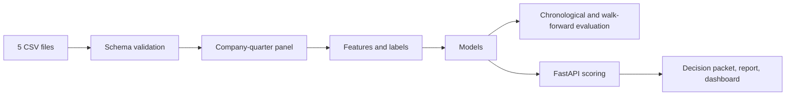

# Quarterly Financial Risk Scoring Service

[日本語](README_JA.md) · [한국어](README_KO.md)

An ML backend that scores three next-quarter risk signals for a company from quarterly data: margin deterioration, market drawdown, and liquidity stress. The focus is the service around the model: input validation, features that only use data available at prediction time, time-ordered evaluation, a FastAPI service, and monitoring reports.

The bundled data is synthetic (40 companies, 20 quarters, 2021Q1 to 2025Q4). Nothing here is investment, lending, or credit advice.

Demo: https://jcicaaa3-cloud.github.io/financial-risk-scoring-service-FINAL/

The demo is a static page. It does not call the Python service. `site/app.js` scores the sample companies with a simple heuristic so the page works on GitHub Pages.

## How it works



- **Input**: five CSV files in one folder (company master, financial statements, market, macro, disclosure features). Columns and rules are in [docs/data_contract.md](docs/data_contract.md).
- **Features**: ratios, quarter-over-quarter changes, and rolling values. Labels are built separately from the prediction-time fields.
- **Models**: a dummy prior, logistic regression, and a random forest are trained per target and compared.
- **Evaluation**: a chronological split and a walk-forward evaluation. No random split.
- **Outputs**: a decision packet (JSON), a Markdown report, a static dashboard, data-quality and drift reports, and a prompt file for an LLM summary. The repository does not call any LLM API.

## Results

Walk-forward evaluation on the synthetic sample, 7 folds (test quarters 2024Q1 to 2025Q3, 40 rows each). Mean over folds, with the range for ROC-AUC. Source: `examples/portfolio_snapshot/walk_forward_metrics.json`.

| Target | ROC-AUC | Average precision | Brier |
| --- | ---: | ---: | ---: |
| Margin deterioration | 0.63 (0.32–0.91) | 0.27 | 0.187 |
| Market drawdown | 0.54 (0.25–0.78) | 0.34 | 0.214 |
| Liquidity stress | 0.78 (0.55–0.93) | 0.39 | 0.123 |

Market drawdown is close to chance, and results swing a lot between folds because each test quarter has only 40 rows. These numbers describe the pipeline on generated data. They say nothing about real companies.

## API

| Method | Path | Purpose |
| --- | --- | --- |
| `GET` | `/health` | Health check |
| `POST` | `/v1/predictions` | Score one company |
| `POST` | `/v1/batch-predictions` | Train once and score several companies |
| `GET` | `/v1/predictions/{request_id}` | Fetch a saved decision packet |
| `GET` | `/v1/models/latest/metrics` | Latest chronological metrics |
| `GET` | `/v1/models/latest/leaderboard` | Model comparison table |
| `GET` | `/v1/models/latest/feature-importance` | Feature importance |
| `GET` | `/v1/monitoring/latest/data-quality` | Data quality report |
| `GET` | `/v1/monitoring/latest/drift` | Quarter drift report |

## Run

```bash
python -m venv .venv
source .venv/bin/activate        # Windows: .venv\Scripts\Activate.ps1
pip install -r requirements.txt

python run_demo.py --company-id C003     # train, score one company, write outputs
pytest -q
uvicorn app.main:app --reload            # API docs at http://127.0.0.1:8000/docs
```

```bash
curl -X POST http://127.0.0.1:8000/v1/predictions \
  -H "Content-Type: application/json" \
  -d '{"company_id":"C003","input_dir":"data/input/sample"}'
```

```bash
docker build -t quarterly-financial-risk-service:latest .
docker run --rm -p 8000:8000 quarterly-financial-risk-service:latest
```

## Layout

```text
app/                          FastAPI entrypoint
src/financial_risk_scoring/   data, features, models, evaluation, monitoring, reporting, service
config/                       data and model settings
data/input/sample/            synthetic sample CSVs
examples/portfolio_snapshot/  outputs from one run (packet, report, dashboard, metrics)
site/                         static demo page
docs/                         data contract, API contract, model card, evaluation protocol
tests/                        pytest
```

## Limitations

- Synthetic data only. A plan for moving to real filings is in [docs/real_data_extension_plan.md](docs/real_data_extension_plan.md).
- The API runs the whole pipeline synchronously inside the request. There is no job queue, model registry, or access control.
- Feature importance is from the model, not causal.

## License

MIT
