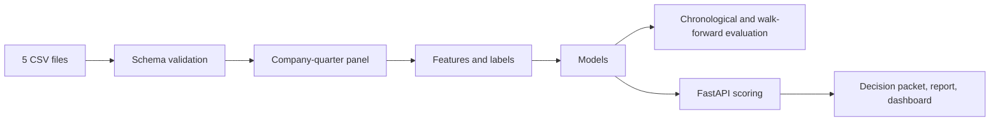

# Quarterly Financial Risk Scoring Service

[English](README.md) · [한국어](README_KO.md)

企業の四半期データから、次の四半期の3つのリスク（利益率の悪化、株価の下落、流動性の逼迫）をスコアにするMLバックエンドです。重点はモデルの周りのサービス部分にあります。入力の検証、予測時点で使えるデータだけで作る特徴量、時系列順の評価、FastAPIのサービス、モニタリングのレポートです。

同梱のデータは合成データです（40社、20四半期、2021Q1〜2025Q4）。投資・融資・信用判断の助言ではありません。

デモ：https://jcicaaa3-cloud.github.io/financial-risk-scoring-service-FINAL/

デモは静的なページで、Pythonのサービスは呼びません。GitHub Pagesで動くように、`site/app.js`がサンプル企業を簡単なヒューリスティックで採点しています。

## 仕組み



- **入力**：1つのフォルダに置いた5つのCSV（企業マスター、財務諸表、市場、マクロ、開示特徴量）。列とルールは[docs/data_contract.md](docs/data_contract.md)にあります。
- **特徴量**：比率、前四半期比の変化、移動集計。ラベルは予測時点の項目とは別に作ります。
- **モデル**：ターゲットごとにダミー（事前確率）、ロジスティック回帰、ランダムフォレストを学習して比べます。
- **評価**：時系列順の分割とウォークフォワード評価。ランダム分割は使いません。
- **出力**：判定パケット（JSON）、Markdownレポート、静的ダッシュボード、データ品質とドリフトのレポート、LLMで要約するためのプロンプトファイル。このリポジトリはLLMのAPIを呼びません。

## 結果

合成サンプルでのウォークフォワード評価、7フォールド（テスト四半期は2024Q1〜2025Q3、各40行）。フォールドの平均で、ROC-AUCには範囲も付けています。出典：`examples/portfolio_snapshot/walk_forward_metrics.json`。

| ターゲット | ROC-AUC | Average precision | Brier |
| --- | ---: | ---: | ---: |
| 利益率の悪化 | 0.63 (0.32–0.91) | 0.27 | 0.187 |
| 株価の下落 | 0.54 (0.25–0.78) | 0.34 | 0.214 |
| 流動性の逼迫 | 0.78 (0.55–0.93) | 0.39 | 0.123 |

株価の下落はほぼ偶然と同じ水準です。テスト四半期が40行しかないので、フォールドごとの振れも大きいです。この数字は生成データ上でのパイプラインの結果で、実在の企業については何も示しません。

## API

| Method | Path | 用途 |
| --- | --- | --- |
| `GET` | `/health` | ヘルスチェック |
| `POST` | `/v1/predictions` | 1社を採点 |
| `POST` | `/v1/batch-predictions` | 1回学習して複数社を採点 |
| `GET` | `/v1/predictions/{request_id}` | 保存済みの判定パケットを取得 |
| `GET` | `/v1/models/latest/metrics` | 最新の時系列評価の指標 |
| `GET` | `/v1/models/latest/leaderboard` | モデル比較表 |
| `GET` | `/v1/models/latest/feature-importance` | 特徴量の重要度 |
| `GET` | `/v1/monitoring/latest/data-quality` | データ品質レポート |
| `GET` | `/v1/monitoring/latest/drift` | 四半期ドリフトレポート |

## 実行

```bash
python -m venv .venv
source .venv/bin/activate        # Windows: .venv\Scripts\Activate.ps1
pip install -r requirements.txt

python run_demo.py --company-id C003     # train, score one company, write outputs
pytest -q
uvicorn app.main:app --reload            # API docs at http://127.0.0.1:8000/docs
```

```bash
curl -X POST http://127.0.0.1:8000/v1/predictions \
  -H "Content-Type: application/json" \
  -d '{"company_id":"C003","input_dir":"data/input/sample"}'
```

```bash
docker build -t quarterly-financial-risk-service:latest .
docker run --rm -p 8000:8000 quarterly-financial-risk-service:latest
```

## 構成

```text
app/                          FastAPIのエントリポイント
src/financial_risk_scoring/   データ、特徴量、モデル、評価、モニタリング、レポート、サービス
config/                       データとモデルの設定
data/input/sample/            合成サンプルCSV
examples/portfolio_snapshot/  1回の実行の出力（パケット、レポート、ダッシュボード、指標）
site/                         静的デモページ
docs/                         データ仕様、API仕様、モデルカード、評価手順
tests/                        pytest
```

## 限界

- 合成データのみです。実際の開示データに移す計画は[docs/real_data_extension_plan.md](docs/real_data_extension_plan.md)にあります。
- APIはリクエストの中でパイプライン全体を同期実行します。ジョブキュー、モデルレジストリ、アクセス制御はありません。
- 特徴量の重要度はモデルから出したもので、因果関係ではありません。

## ライセンス

MIT
