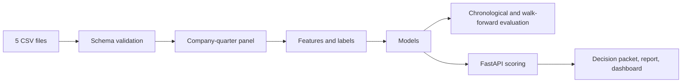

# Quarterly Financial Risk Scoring Service

[English](README.md) · [日本語](README_JA.md)

기업의 분기 데이터로 다음 분기의 리스크 세 가지(마진 악화, 주가 하락, 유동성 압박)를 점수로 내는 ML 백엔드입니다. 모델보다 모델을 둘러싼 서비스 부분에 무게를 뒀습니다. 입력 검증, 예측 시점에 쓸 수 있는 데이터만으로 만드는 피처, 시간 순서를 지키는 평가, FastAPI 서비스, 모니터링 리포트입니다.

들어 있는 데이터는 합성 데이터입니다(40개 기업, 20개 분기, 2021Q1~2025Q4). 투자·대출·신용 판단용 조언이 아닙니다.

데모: https://jcicaaa3-cloud.github.io/financial-risk-scoring-service-FINAL/

데모는 정적 페이지이고 Python 서비스를 호출하지 않습니다. GitHub Pages에서 돌아가도록 `site/app.js`가 샘플 기업을 간단한 휴리스틱으로 채점합니다.

## 동작 방식



- **입력**: 한 폴더에 둔 CSV 5개(기업 마스터, 재무제표, 시장, 거시, 공시 피처). 열과 규칙은 [docs/data_contract.md](docs/data_contract.md)에 있습니다.
- **피처**: 비율, 전 분기 대비 변화, 이동 집계. 라벨은 예측 시점 항목과 따로 만듭니다.
- **모델**: 타깃마다 더미(사전 확률), 로지스틱 회귀, 랜덤 포레스트를 학습해서 비교합니다.
- **평가**: 시간순 분할과 워크포워드 평가. 랜덤 분할은 쓰지 않습니다.
- **출력**: 판정 패킷(JSON), Markdown 리포트, 정적 대시보드, 데이터 품질·드리프트 리포트, LLM 요약용 프롬프트 파일. 이 레포는 LLM API를 호출하지 않습니다.

## 결과

합성 샘플에서 돌린 워크포워드 평가, 7개 폴드(테스트 분기 2024Q1~2025Q3, 각 40행)입니다. 폴드 평균이고 ROC-AUC에는 범위를 같이 적었습니다. 출처: `examples/portfolio_snapshot/walk_forward_metrics.json`.

| 타깃 | ROC-AUC | Average precision | Brier |
| --- | ---: | ---: | ---: |
| 마진 악화 | 0.63 (0.32–0.91) | 0.27 | 0.187 |
| 주가 하락 | 0.54 (0.25–0.78) | 0.34 | 0.214 |
| 유동성 압박 | 0.78 (0.55–0.93) | 0.39 | 0.123 |

주가 하락은 거의 찍는 수준입니다. 테스트 분기가 40행뿐이라 폴드마다 편차도 큽니다. 이 숫자는 생성한 데이터에서 파이프라인을 돌린 결과이고, 실제 기업에 대해서는 아무것도 말해 주지 않습니다.

## API

| Method | Path | 용도 |
| --- | --- | --- |
| `GET` | `/health` | 상태 확인 |
| `POST` | `/v1/predictions` | 기업 하나 채점 |
| `POST` | `/v1/batch-predictions` | 한 번 학습하고 여러 기업 채점 |
| `GET` | `/v1/predictions/{request_id}` | 저장된 판정 패킷 조회 |
| `GET` | `/v1/models/latest/metrics` | 최신 시간순 평가 지표 |
| `GET` | `/v1/models/latest/leaderboard` | 모델 비교표 |
| `GET` | `/v1/models/latest/feature-importance` | 피처 중요도 |
| `GET` | `/v1/monitoring/latest/data-quality` | 데이터 품질 리포트 |
| `GET` | `/v1/monitoring/latest/drift` | 분기 드리프트 리포트 |

## 실행

```bash
python -m venv .venv
source .venv/bin/activate        # Windows: .venv\Scripts\Activate.ps1
pip install -r requirements.txt

python run_demo.py --company-id C003     # train, score one company, write outputs
pytest -q
uvicorn app.main:app --reload            # API docs at http://127.0.0.1:8000/docs
```

```bash
curl -X POST http://127.0.0.1:8000/v1/predictions \
  -H "Content-Type: application/json" \
  -d '{"company_id":"C003","input_dir":"data/input/sample"}'
```

```bash
docker build -t quarterly-financial-risk-service:latest .
docker run --rm -p 8000:8000 quarterly-financial-risk-service:latest
```

## 구성

```text
app/                          FastAPI 진입점
src/financial_risk_scoring/   데이터, 피처, 모델, 평가, 모니터링, 리포트, 서비스
config/                       데이터·모델 설정
data/input/sample/            합성 샘플 CSV
examples/portfolio_snapshot/  한 번 실행한 결과(패킷, 리포트, 대시보드, 지표)
site/                         정적 데모 페이지
docs/                         데이터 규격, API 규격, 모델 카드, 평가 절차
tests/                        pytest
```

## 한계

- 합성 데이터만 씁니다. 실제 공시 데이터로 옮기는 계획은 [docs/real_data_extension_plan.md](docs/real_data_extension_plan.md)에 있습니다.
- API가 요청 안에서 파이프라인 전체를 동기로 실행합니다. 작업 큐, 모델 레지스트리, 접근 제어는 없습니다.
- 피처 중요도는 모델에서 뽑은 값이고 인과관계가 아닙니다.

## 라이선스

MIT
