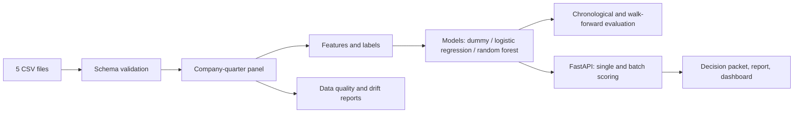

# Architecture

## Flow

1. **Input** takes five CSV files from one input directory.
2. **Features** validates the schema, builds a company-quarter panel, creates ratio and trend features, and keeps labels separate from fields available at prediction time.
3. **Models** trains and compares dummy, logistic regression, and random forest baselines with chronological and walk-forward validation.
4. **Service** exposes single-company prediction, batch scoring, metrics, leaderboard, feature-importance, and monitoring endpoints.
5. **Outputs** are decision packets, Markdown reports, a prompt file for an LLM summary, a static dashboard, metrics, data-quality reports, and drift reports.

## Current service boundary

The FastAPI service runs the whole pipeline synchronously inside the request. A production version would normally separate this into:

- async job queue,
- persistent model registry,
- database-backed request tracking,
- scheduled retraining jobs,
- monitoring dashboards,
- audit logs,
- access control,
- model-risk approval workflow.
